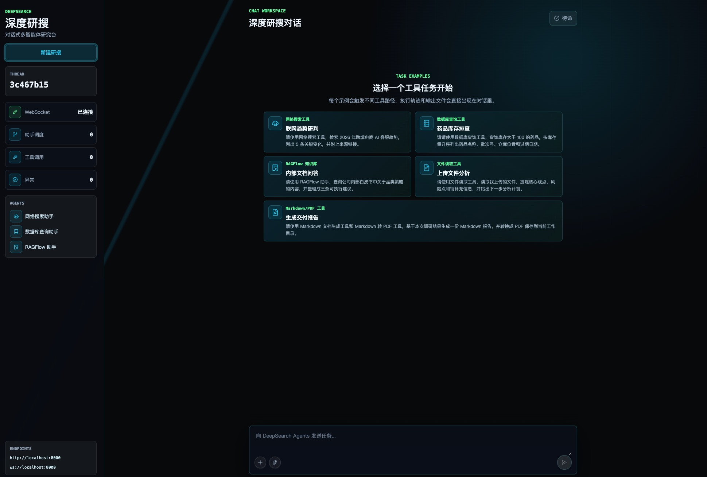
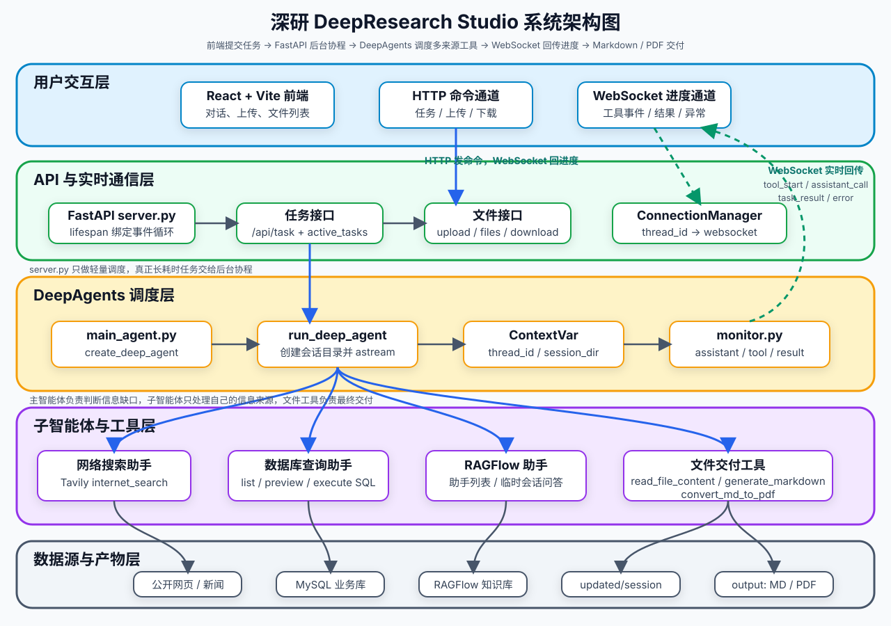
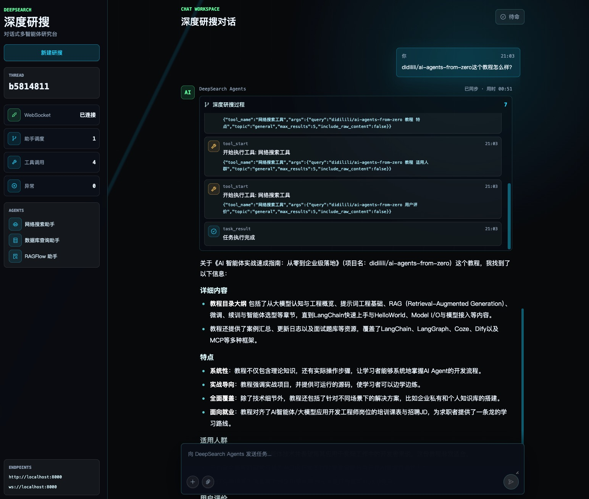

<div align='center'>
  <h1 style="margin-top: 15px;">「深研」DeepResearch Studio</h1>
  <h4><b>deepresearch-studio · 对话式多智能体深度研究平台</b></h4>
  <p><em>基于 DeepAgents + LangGraph 的深度研究多智能体系统：本地 FAISS 向量知识库、SQLite 会话持久化、任务生命周期管理、pytest + CI 全链路测试</em></p>
</div>

<div align='center'>


[快速开始](#quick-start) • [项目亮点](#features) • [系统架构](#architecture) • [改造说明](#changelog)

</div>

> **📌 项目来源**：本项目基于开源教学项目 [didilili/deepsearch-agents](https://github.com/didilili/deepsearch-agents)（DeepAgents 教程体系 [ai-agents-from-zero](https://github.com/didilili/ai-agents-from-zero) 的实战项目，版权归原作者 didilili 所有）二次开发，在原版多智能体骨架基础上完成了本地 RAG、会话持久化、任务管理、测试与 CI 等工程化改造，逐项记录见文末[改造说明](#changelog)。

如果你正在找一个适合学习 `DeepAgents`、`LangGraph`、`WebSocket`、`Tavily`、本地 RAG 和 AI Agent 工程开发的实战项目，这个仓库可能是最适合你的项目。

它不是只调用一次大模型接口，也不是套一个搜索 API 做问答演示。这个项目围绕深度研究场景，用 DeepAgents 组织主智能体和专家子智能体，让系统可以根据任务需要查公开网络、查结构化数据库、查本地向量知识库、读取用户上传附件，并把最终结果整理成回答、Markdown 或 PDF。换句话说，你学到的不是某一个框架 API，而是一条 AI 应用从多智能体规划、工具接入、上下文隔离、持久化、接口交付到前端联调的完整项目主线。



## 📖 项目介绍

在真实研究场景里，用户的问题经常不是一句普通问答可以解决的。

比如：

```text
结合公开资料、数据库信息和我上传的文档，整理一份机器人行业研究报告，并生成 PDF。
```

这个任务背后可能包含多类动作：

- 判断需要公开资料、内部数据、私有知识库还是本次上传文件；
- 去互联网搜索最新新闻、政策、产品或行业资料；
- 到 MySQL 查询企业结构化业务数据；
- 到本地 FAISS 向量知识库检索内部非结构化文档；
- 读取用户上传的 PDF、Word、Excel、Markdown 或文本文件；
- 汇总多来源信息，判断资料是否足够；
- 生成 Markdown 报告，并在需要时转换成 PDF；
- 把执行过程、最终结果和生成文件实时展示给前端。

所以「深研」更像一个会分工、会查资料、会生成交付物的研究助手。用户只需要提出任务，系统会在后端组织一条可观察的多智能体执行链路。

```text
用户任务
  -> FastAPI 接口接收请求（任务登记入 SQLite）
  -> run_deep_agent 创建会话目录并写入上下文
  -> 主智能体分析任务
  -> 分派给网络搜索助手 / 数据库查询助手 / 知识库助手
  -> 主智能体汇总多来源信息
  -> 调用文件工具生成 Markdown / PDF
  -> monitor 通过 WebSocket 推送进度
  -> 前端展示事件、答案和文件列表
```

<a id="features"></a>

## ✨ 项目亮点

- **一主三从的多智能体架构**
  - 主智能体负责理解任务、规划步骤、调度助手和最终汇总。
  - 网络搜索助手、数据库查询助手、知识库助手分别处理不同信息来源。
- **多来源检索，而不是模型裸答**
  - `Tavily` 负责互联网公开资料检索。
  - `MySQL` 负责查询结构化业务数据。
  - `本地 FAISS 向量库` 负责检索内部非结构化文档（PDF/Word/Markdown 分片语义检索）。
  - 上传附件由主智能体通过文件工具读取。
- **知识库能力完全本地化，零外部服务依赖**
  - 原版依赖外部 RAGFlow 服务，本版改为项目内 FAISS 向量库：文档入库、分片、向量化、检索全链路自有实现；
  - 附带 `python -m app.rag.ingest` 入库脚本，`docs/knowledge_base/` 下每个子目录自动构建为一个知识库集合。
- **从检索到交付的完整可运行链路**
  - 不停留在 Prompt 设计，而是会真实调用工具、读取数据、生成 Markdown，并在需要时转换成 PDF。
- **会话持久化，重启不丢历史**
  - `AsyncSqliteSaver` 替代 `InMemorySaver`，按 `thread_id` 持久化 LangGraph 检查点，服务重启后可恢复历史会话上下文；
  - 检查点类型通过 `CHECKPOINTER_TYPE` 环境变量在 sqlite / memory 间切换。
- **任务生命周期可查询**
  - 任务提交、运行、完成、失败、取消全状态落库（`TaskStore`），提供 `GET /api/tasks`、`GET /api/task/{thread_id}` 查询接口，失败原因可追溯。
- **长任务执行过程可观察**
  - 工具调用、子智能体调用、工作目录创建、任务结果、取消和异常都会通过 `monitor` 推送到前端。
- **会话级上下文隔离**
  - 通过 `thread_id` 和 `session_dir` 区分不同任务，`ContextVar` 让深层工具也能拿到当前会话身份和文件目录。
- **工程化前后端结构清晰**
  - 基于 `FastAPI + WebSocket + DeepAgents + React` 组织任务接口、异步执行、事件推送、文件上传和文件下载。
- **测试与 CI 全覆盖**
  - 159 个 pytest 用例覆盖路径解析与写入边界、文件工具、数据库工具（mock）、向量库全链路（FakeEmbeddings）、检查点、任务存储、认证与资源隔离、API/WebSocket、智能体组装；
  - GitHub Actions 流水线：ruff lint + ruff format + pytest。
- **多用户体系与资源隔离（第一期安全改造）**
  - 注册 / 登录 + JWT 认证，除认证接口外的所有资源接口默认要求登录；
  - 任务、上传文件、输出目录、私有知识库全部按 `user_id` 隔离，接口层校验资源归属，跨用户访问一律按 404 拒绝；
  - 前端带登录/注册页，JWT 经 Authorization 头与 WebSocket query 参数传递。
- **工具层与接口层硬安全校验**
  - SQL 工具：只读校验（仅 SELECT/SHOW/WITH/EXPLAIN）、DDL/DML 关键字黑名单、多语句拦截、注释绕过防护、表名白名单；
  - 上传：扩展名白名单、单文件大小上限（流式实时校验）、文件名清洗（防路径穿越）；
  - 限流：任务提交按用户、登录按 IP+用户名，超限返回 429。

这套课程与改造实践十分适合这些场景：

- 想系统学习 `DeepAgents`，但不想只停留在几个玩具示例。
- 想把 `Tavily`、`MySQL`、本地 RAG 和大模型放到同一个研究助手场景里理解。
- 想做一个比简单模型调用更接近真实开发的 AI Agent 项目。
- 想把项目写进简历，并且能说清楚智能体层、工具层、服务层、文件层和前端层分别做了什么。

<a id="architecture"></a>

## 🏗️ 系统架构



项目采用 DeepAgents 中典型的 Orchestrator-Workers 模式：主智能体作为调度中心，三个专家助手负责信息获取，文件工具由主智能体直接掌握。

项目围绕两条主线展开：

| 主线             | 做什么                                                       | 涉及模块                                                                  |
| ---------------- | ------------------------------------------------------------ | ------------------------------------------------------------------------- |
| 多智能体深度研究 | 基于用户任务完成规划、分派、检索、读取附件、汇总和生成交付物 | `DeepAgents` / `LangChain` / `LangGraph` / `Tavily` / `MySQL` / `FAISS` |
| 前后端实时闭环   | 启动后台任务、上传文件、推送执行过程、展示结果和下载生成文件 | `FastAPI` / `WebSocket` / `React` / `Vite`                                |

### 智能体与工具

| 归属           | 能力                                     | 工具                                                          |
| -------------- | ---------------------------------------- | ------------------------------------------------------------- |
| 主智能体       | 任务规划、助手调度、结果汇总、文件交付   | `read_file_content`、`generate_markdown`、`convert_md_to_pdf` |
| 网络搜索助手   | 查询互联网公开信息、新闻、政策和网页资料 | `internet_search`                                             |
| 数据库查询助手 | 发现表名、预览表结构和样例数据、执行 SQL | `list_sql_tables`、`get_table_data`、`execute_sql_query`      |
| 知识库助手     | 发现本地向量知识库集合，并在集合内语义检索 | `list_knowledge_collections`、`search_knowledge_base`         |



## 🛠️ 项目技术栈

| 模块           | 技术                                             | 作用                                                                          |
| -------------- | ------------------------------------------------ | ----------------------------------------------------------------------------- |
| 智能体框架     | `DeepAgents`                                     | 创建主智能体和子智能体，承接长任务、多工具、多助手调度                        |
| 图与检查点     | `LangGraph` / `langgraph-checkpoint-sqlite`      | 底层运行时；`AsyncSqliteSaver` 持久化会话检查点（可切换内存模式）           |
| 模型与工具抽象 | `LangChain` / `langchain-core`                   | 封装 OpenAI 兼容模型、工具声明和 Agent 调用结构                               |
| 大模型接入     | OpenAI 兼容接口                                  | 通过 `.env` 中的 `OPENAI_BASE_URL`、`OPENAI_API_KEY`、`LLM_QWEN_MAX` 接入模型 |
| Embedding      | OpenAI 兼容接口                                  | 通过 `EMBEDDING_MODEL` 配置（如百炼 `text-embedding-v3`）                     |
| 本地 RAG       | `FAISS` / `langchain-community`                  | 本地向量索引与语义检索，替代原外部 RAGFlow 服务                               |
| 网络搜索       | `Tavily`                                         | 为网络搜索助手提供公开资料检索                                                |
| 结构化数据     | `MySQL` / `mysql-connector-python`               | 为数据库助手提供药品、库存、销售等教学业务数据                                |
| 文件处理       | `pypdf` / `python-docx` / `pandas` / `ReportLab` | 读取上传附件，生成 Markdown，转换 PDF                                         |
| 后端接口       | `FastAPI` / `Uvicorn`                            | 提供任务、取消、上传、文件列表、下载和 WebSocket 接口                         |
| 实时通信       | `WebSocket`                                      | 推送工具调用、助手调用、最终结果和错误事件                                    |
| 用户认证       | `PyJWT` / `pbkdf2-hmac`                          | 注册登录、JWT 签发校验、密码哈希存储                                          |
| 前端           | `React` / `Vite` / `Ant Design` / `Tailwind CSS` | 提供登录注册、对话式研搜界面、事件流、附件上传和文件下载                      |
| 测试与 CI      | `pytest` / `ruff` / `GitHub Actions`             | 单元与接口测试、代码规范检查、持续集成                                        |
| 依赖管理       | `uv` / `pnpm`                                    | 管理 Python 后端和前端依赖                                                    |

## 📁 项目结构

```text
deepresearch-studio/
├── app/
│   ├── agent/
│   │   ├── subagents/              # 网络搜索、数据库查询、知识库三个子智能体
│   │   ├── checkpointer.py         # SQLite/内存检查点工厂
│   │   ├── llm.py                  # OpenAI 兼容模型初始化
│   │   ├── main_agent.py           # 主智能体组装与 run_deep_agent 执行入口
│   │   └── prompts.py              # 读取 app/prompt/prompts.yml
│   ├── api/
│   │   ├── auth.py                 # 用户存储、JWT 认证、登录依赖（新增）
│   │   ├── context.py              # ContextVar 保存 thread_id、session_dir 和 user_id
│   │   ├── monitor.py              # 工具调用、助手调用、结果和异常事件推送
│   │   ├── rate_limit.py           # 滑动窗口限流器（新增）
│   │   ├── server.py               # FastAPI 全部接口
│   │   ├── task_store.py           # SQLite 任务生命周期存储（含归属用户）
│   │   └── upload_guard.py         # 上传文件校验与清洗（新增）
│   ├── prompt/
│   │   └── prompts.yml             # 主智能体和子智能体提示词配置
│   ├── rag/                        # 本地向量知识库（替代原 ragflow 目录）
│   │   ├── embeddings.py           # OpenAI 兼容 Embedding 客户端
│   │   ├── ingest.py               # 文档入库脚本：docs/knowledge_base -> FAISS
│   │   └── vector_store.py         # FAISS 集合管理与检索
│   ├── tools/                      # Tavily、MySQL、向量库、文件读取、Markdown、PDF 工具
│   │   └── sql_guard.py            # SQL 只读校验与表名白名单（新增）
│   ├── utils/                      # 路径解析、日志配置、Markdown/PDF 底层转换
│   ├── data/                       # 运行时生成：向量库索引、检查点与用户数据库（git 忽略）
│   ├── output/                     # 运行时生成：按用户/会话隔离的 Markdown、PDF 等产物
│   └── updated/                    # 运行时生成：按用户/会话隔离的上传暂存目录
├── tests/                          # pytest 测试套件
├── .github/workflows/ci.yml        # GitHub Actions 持续集成
├── docker/
│   ├── docker-compose.yaml         # 本地 MySQL 教学环境
│   └── mysql/mysql.sql             # 药品、库存、销售记录模拟数据
├── docs/knowledge_base/            # 知识库示例 PDF（入库脚本的数据源）
├── examples/                       # DeepAgents 章节示例脚本
├── frontend/                       # React + Vite 前端项目（含登录注册页）
├── .env.example                    # 环境变量示例
├── pyproject.toml                  # Python 项目依赖与工具链声明
├── requirements.txt                # 依赖清单
└── uv.lock                         # uv 锁定文件
```

<a id="quick-start"></a>

## 🚀 快速开始

### 1. 准备环境

- Python `3.12`
- `uv`
- Docker 与 Docker Compose
- Node.js 与 `pnpm`
- 可用的大模型 API Key（OpenAI 兼容，默认示例为阿里云百炼）
- Tavily API Key

> 与原版相比，不再需要部署 RAGFlow 服务；知识库检索由项目内 FAISS 完成。

### 2. 克隆项目

```bash
# 克隆你自己的 fork（或本改造版仓库）
git clone <你的仓库地址>
cd deepresearch-studio
```

### 3. 安装后端依赖

```bash
uv sync --group dev
```

### 4. 配置环境变量

```bash
cp .env.example .env
```

按本机实际服务和密钥修改 `.env`：

```bash
# LLM 配置（OpenAI 兼容）
OPENAI_BASE_URL=https://dashscope.aliyuncs.com/compatible-mode/v1
OPENAI_API_KEY=你的大模型_API_KEY
LLM_QWEN_MAX=qwen-max

# Embedding 配置（知识库入库与检索共用）
EMBEDDING_MODEL=text-embedding-v3

# Tavily 配置
TAVILY_API_KEY=你的_TAVILY_API_KEY

# 本地向量知识库目录
VECTOR_STORE_DIR=app/data/vector_store

# 会话检查点：sqlite（默认，持久化）或 memory
CHECKPOINTER_TYPE=sqlite
CHECKPOINTER_DB=app/data/checkpoints.db

# 用户认证：AUTH_ENABLED=false 可退化为开发用户（免登录调试）
AUTH_ENABLED=true
JWT_SECRET=请改成足够长的随机密钥
JWT_EXPIRE_MINUTES=1440
AUTH_DB=app/data/users.db

# MySQL 配置
MYSQL_USER=root
MYSQL_PASSWORD=root
MYSQL_DATABASE=deepresearch_db
MYSQL_HOST=localhost
MYSQL_PORT=3307
MYSQL_CHARSET=utf8mb4
MYSQL_COLLATION=utf8mb4_unicode_ci
MYSQL_SQL_MODE=TRADITIONAL
```

### 5. 启动 MySQL 教学库

本仓库的 `docker/mysql/mysql.sql` 会在 MySQL 容器首次创建数据目录时自动导入药品、库存和销售记录模拟数据。

```bash
docker compose -f docker/docker-compose.yaml up -d
```

### 6. 构建本地向量知识库

入库脚本会扫描 `docs/knowledge_base/` 下的每个子目录，将其构建为一个 FAISS 集合（电商行业、金融行业等）：

```bash
uv run python -m app.rag.ingest
```

只重建指定集合：

```bash
uv run python -m app.rag.ingest --collection 金融行业
```

知识库检索依赖 Embedding 服务，不配置 `EMBEDDING_MODEL` 对应密钥时，网络搜索、数据库查询和文件读取链路不受影响，只有任务触发知识库助手时才需要。

### 7. 启动后端

```bash
uv run uvicorn app.api.server:app --host 0.0.0.0 --port 8000 --reload
```

后端默认接口：

| 接口                                | 说明                                         |
| ----------------------------------- | -------------------------------------------- |
| `POST /api/auth/register`           | 注册新用户并直接返回 JWT（新增）             |
| `POST /api/auth/login`              | 登录并签发 JWT（新增）                       |
| `GET /api/auth/me`                  | 查询当前登录用户（新增）                     |
| `POST /api/task`                    | 启动一次 DeepAgents 后台任务（需登录、限流） |
| `POST /api/task/{thread_id}/cancel` | 取消指定会话任务（校验归属）                 |
| `GET /api/tasks`                    | 查询本人最近任务列表及状态                   |
| `GET /api/task/{thread_id}`         | 查询本人单个任务状态详情                     |
| `POST /api/upload`                  | 上传文件到本人会话目录（类型/大小校验）      |
| `GET /api/files`                    | 列出本人输出目录中的生成文件                 |
| `GET /api/download`                 | 下载本人输出目录中的文件                     |
| `WebSocket /ws/{thread_id}`         | 推送工具调用、助手调用、结果和异常事件       |

除注册/登录外的接口都需要 JWT 认证：HTTP 接口走 `Authorization: Bearer <token>`
请求头；浏览器 `<a href>` 直链下载额外支持 `?token=` 查询参数；
WebSocket 走 `?token=` 查询参数（浏览器 WebSocket 不支持自定义请求头）。

### 8. 启动前端

```bash
cd frontend
pnpm install
pnpm dev
```

前端默认连接：

```text
API: http://localhost:8000
WS:  ws://localhost:8000
```

如需修改，可以在 `frontend/.env.local` 中配置：

```bash
VITE_API_BASE_URL=http://localhost:8000
VITE_WS_BASE_URL=ws://localhost:8000
```

首次打开页面会进入登录/注册页：注册账号后自动登录，任务、上传文件、
输出产物和私有知识库都按用户隔离。本地调试如果不想走登录流程，可以设置
`AUTH_ENABLED=false` 退化为单一开发用户。

### 9. 试几个任务

```text
从数据库中查询心血管药品的库存情况，并生成 Markdown 报告。
```

```text
搜索 2026 年 AI 在电商行业的应用趋势，并结合本地知识库资料生成一份 PDF。
```

```text
请先读取我上传的行业报告，再结合公开资料整理一份研究摘要。
```

### 10. 运行测试

```bash
uv run python -m pytest          # 运行全部测试
uv run ruff check app tests      # 代码规范检查
uv run ruff format --check app tests  # 格式检查
```

<a id="changelog"></a>

## 🔧 改造说明（相对原版的变化）

本仓库在原教学项目基础上完成了以下工程化改造，按主题分组：

### 1. 本地 FAISS 向量知识库替代外部 RAGFlow

| 变化 | 说明 |
| --- | --- |
| 删除 `app/ragflow/`、`app/tools/ragflow_tools.py` | 不再依赖外部 RAGFlow 服务与 `ragflow-sdk` |
| 新增 `app/rag/` 包 | `vector_store.py`（集合管理/检索）、`embeddings.py`（OpenAI 兼容 Embedding）、`ingest.py`（文档入库 CLI） |
| 新增工具 | `list_knowledge_collections` + `search_knowledge_base` 替代原 `get_assistant_list` + `create_ask_delete`，工作流从"查助手再提问"改为"查集合再检索" |
| 磁盘布局 | `app/data/vector_store/<集合>/` 下保存 `index.faiss`、`index.pkl`、`meta.json` |

**实现中解决的两个真实问题**：

- **FAISS 中文路径写入失败**：`faiss.write_index` 走 C++ 窄字符文件 IO，Windows 上路径含任何非 ASCII 字符（中文项目目录、中文系统用户名）都会失败。改造后索引序列化改用 `faiss.serialize_index` 得到字节数组、由 Python 写盘，集合目录使用"ASCII 片段 + 名称哈希"的 slug，中文展示名保留在 `meta.json`。
- **知识库发现不依赖密钥**：集合列表只读 `meta.json`，未配置 Embedding 密钥时也能列出可用集合。

### 2. SQLite 持久化会话检查点

- 新增 `app/agent/checkpointer.py`：`CHECKPOINTER_TYPE=sqlite`（默认）时使用 `AsyncSqliteSaver` 持久化到 `app/data/checkpoints.db`，服务重启后按 `thread_id` 恢复会话上下文；`memory` 模式保留原 `InMemorySaver` 行为供调试。
  - 实现要点：主智能体通过 `astream` 异步执行，LangGraph 只会调用检查点的异步接口，同步的 `SqliteSaver` 在异步图里会直接报错，因此必须选用 `AsyncSqliteSaver`（aiosqlite 驱动）；相应地主智能体改为惰性异步组装（首次任务时创建，带并发锁）。

### 3. 任务生命周期管理

- 新增 `app/api/task_store.py`：任务状态（running/completed/failed/cancelled）、提交时间、错误信息落库；
- `run_deep_agent` 在结束、取消、异常时同步更新状态；
- 新增 `GET /api/tasks`、`GET /api/task/{thread_id}` 查询接口。

### 4. 测试与 CI

- 新增 `tests/`：159 个用例，覆盖路径解析与写入边界（含 `../` 穿越防护）、文件工具、数据库工具（mock MySQL 连接）、向量库全链路（FakeEmbeddings 确定性向量）、检查点两种模式、任务存储、认证与跨用户隔离、上传与限流、FastAPI 接口与 WebSocket、智能体组装；
- 新增 `.github/workflows/ci.yml`：ruff lint + ruff format + pytest；
- `pyproject.toml` 增加 `dev` 依赖组（pytest、pytest-asyncio、pytest-cov、ruff、httpx）与工具链配置。

### 5. 第一期：安全与多用户基础

**用户体系**

- 新增 `app/api/auth.py`：SQLite 用户存储、PBKDF2-SHA256 密码哈希（标准库实现，随机盐 + 10 万次迭代）、PyJWT 签发与校验、`get_current_user` FastAPI 依赖；
- 新增接口：`POST /api/auth/register`（注册即登录）、`POST /api/auth/login`、`GET /api/auth/me`；
- 前端新增登录/注册页（`components/AuthPanel.tsx`），JWT 经 Authorization 头传递，下载直链和 WebSocket 走 token 查询参数；
- `AUTH_ENABLED=false` 时退化为单一开发用户，方便本地无登录调试。

**资源按用户隔离**

- `session_dir`、上传暂存目录、输出目录全部按 `user_id` 分层：`output/user_{id}/session_{thread_id}`；
- 任务表增加 `user_id` 列（含旧库 ALTER TABLE 迁移），任务查询/取消、文件列表/下载都校验归属，跨用户访问一律 404；
- 知识库支持“用户私有库 + 共享库”分层：`VECTOR_STORE_DIR/user_{id}` 为私有集合，根目录为公开集合，检索时私有优先、互不越界；
- WebSocket 连接校验 token 与 thread 归属，拒绝跨用户订阅执行事件。

**SQL 防护（工具层硬校验）**

- 新增 `app/tools/sql_guard.py`：仅允许 SELECT/SHOW/WITH/EXPLAIN 开头；词边界匹配拦截 DROP/DELETE/UPDATE/INSERT 等关键字；剥离注释后校验，防注释绕过；拒绝多语句执行；`get_table_data` 的表名过白名单（字母、数字、下划线、中文）；
- 模型生成危险 SQL 时工具直接返回拒绝原因，不触达数据库。

**上传安全**

- 新增 `app/api/upload_guard.py`：扩展名白名单（可配置）、单文件大小上限（流式写入实时计数，超限即中断并删除半成品）、文件名清洗（剥离目录成分与控制字符，拒绝隐藏文件）；
- 实现中修复一个真实缺陷：`strip(".")` 会连隐藏文件的前导点一起剥掉，导致 `.env` 类文件绕过检查，已改为只剥离尾部点号。

**接口限流**

- 新增 `app/api/rate_limit.py`：内存滑动窗口限流器；任务提交按用户（默认 10 次/分钟），登录按 IP+用户名（默认 5 次/分钟），超限返回 429 + Retry-After；
- 多实例部署需换 Redis 共享计数，已列入第二期规划。

### 6. 健壮性与日志

- 修复**无 `TAVILY_API_KEY` 时应用导入即崩溃**的问题：Tavily 客户端改惰性初始化，未配置密钥时仅网络搜索不可用，其他链路正常启动；
- 修复**未配置 `LLM_QWEN_MAX` 时启动报错含义不明**的问题：模型初始化入口直接校验并给出可操作提示（原实现在 deepagents 组装阶段才抛出 `TypeError`）；
- 全项目 `print` 日志统一为 `logging` 结构化日志（`app/utils/logging_config.py`），服务启动时统一初始化；
- 修复文件工具的**路径穿越漏洞**：新增 `resolve_write_path`，模型传入 `../` 或目录外绝对路径时，产物强制收敛回当前会话目录；
- 修复 **WebSocket 重复 accept** 的协议错误：认证辅助函数不再调用 accept，统一由 ConnectionManager 执行；
- 任务列表同一秒内提交时排序不稳定，增加 `rowid` 次级排序；
- 修正 `prompts.py` 模块级遗留的调试 `print`；前端知识库文案同步更新。

## 📚 配套教程目录

教程总入口：[深度研搜完整教程](https://didilili.github.io/ai-agents-from-zero/#/实战项目-深度研搜/0-前言)

| 章节 | 标题                                                                                                                                   | 学习重点                                                      | 对应分支                              |
| ---- | -------------------------------------------------------------------------------------------------------------------------------------- | ------------------------------------------------------------- | ------------------------------------- |
| 0    | [前言](https://didilili.github.io/ai-agents-from-zero/#/实战项目-深度研搜/0-前言)                                                      | 项目定位、学习价值、技术栈和能力边界                          | `-`                                   |
| 1    | [DeepAgents 基础与核心概念](https://didilili.github.io/ai-agents-from-zero/#/实战项目-深度研搜/1-DeepAgents基础与核心概念)             | 智能体演进、框架定位、核心能力和多智能体设计边界              | `-`                                   |
| 2    | [DeepAgents 快速入门与流式解析](https://didilili.github.io/ai-agents-from-zero/#/实战项目-深度研搜/2-DeepAgents快速入门与流式解析)     | `create_deep_agent()`、`invoke`、`stream`、`chunk`            | `02-quickstart-streaming`             |
| 3    | [子智能体进阶与异步执行](https://didilili.github.io/ai-agents-from-zero/#/实战项目-深度研搜/3-子智能体进阶与异步执行)                  | 字典式子智能体、助手调度、`astream` 和嵌套边界                | `03-deepagents-subagents-async`       |
| 4    | [接入 LangGraph 与 LangChain](https://didilili.github.io/ai-agents-from-zero/#/实战项目-深度研搜/4-接入LangGraph与LangChain)           | `CompiledSubAgent`、LangGraph 子图、LangChain Agent 包装      | `04-deepagents-langgraph-langchain`   |
| 5    | [人机协作与中断恢复](https://didilili.github.io/ai-agents-from-zero/#/实战项目-深度研搜/5-人机协作与中断恢复)                          | 人工审批、编辑工具参数、中断和恢复执行                        | `05-deepagents-hitl-interrupt`        |
| 6    | [长期记忆与 Backend 存储](https://didilili.github.io/ai-agents-from-zero/#/实战项目-深度研搜/6-长期记忆与Backend存储)                  | `FilesystemBackend`、`StoreBackend`、`CompositeBackend`       | `06-deepagents-backends-memory`       |
| 7    | [中间件机制与 Skills 配置](https://didilili.github.io/ai-agents-from-zero/#/实战项目-深度研搜/7-中间件机制与Skills配置)                | 上下文摘要、模型调用限制、工具调用限制、自定义中间件和 Skills | `07-deepagents-middleware-governance` |
| 8    | [项目总览与工程初始化](https://didilili.github.io/ai-agents-from-zero/#/实战项目-深度研搜/8-项目总览与工程初始化)                      | 一主三从架构、工具、前后端交互、工程目录                      | `09-deepsearch-core-config`           |
| 9    | [基础模块与模型配置](https://didilili.github.io/ai-agents-from-zero/#/实战项目-深度研搜/9-基础模块与模型配置)                          | `.env`、`ContextVar`、`monitor`、路径工具、模型和提示词配置   | `09-deepsearch-core-config`           |
| 10   | [网络搜索子智能体与 Tavily 工具](https://didilili.github.io/ai-agents-from-zero/#/实战项目-深度研搜/10-网络搜索子智能体与Tavily工具)   | `internet_search`、Tavily 配置、网络搜索助手组装和进度上报    | `10-deepsearch-network-subagent`      |
| 11   | [数据库查询子智能体与 MySQL 工具](https://didilili.github.io/ai-agents-from-zero/#/实战项目-深度研搜/11-数据库查询子智能体与MySQL工具) | 本地 MySQL、查表、预览数据、执行 SQL、数据库助手组装          | `11-deepsearch-database-subagent`     |
| 12   | [RAGFlow 子智能体与知识库准备](https://didilili.github.io/ai-agents-from-zero/#/实战项目-深度研搜/12-RAGFlow子智能体与知识库准备)      | RAGFlow 部署、助手列表查询、临时会话问答、知识库助手组装      | `12-deepsearch-ragflow-subagent`      |
| 13   | [主智能体搭建与异步执行](https://didilili.github.io/ai-agents-from-zero/#/实战项目-深度研搜/13-主智能体搭建与异步执行)                 | 主智能体组装、上传文件读取、Markdown/PDF 工具、会话目录隔离   | `13-deepsearch-main-agent`            |
| 14   | [FastAPI 接口与项目闭环](https://didilili.github.io/ai-agents-from-zero/#/实战项目-深度研搜/14-FastAPI接口与项目闭环)                  | 任务启动/取消、上传、文件列表、下载、WebSocket 和前端联调     | `14-deepsearch-api-websocket`         |

> 注：教程第 12 章对应原版的 RAGFlow 方案；本改造版已将知识库助手替换为本地 FAISS 实现，可对照 `app/rag/` 目录理解差异。

## 🚧 能力边界

改造版覆盖了 DeepAgents 多智能体调度、真实工具接入、本地 RAG、文件交付、FastAPI 接口、WebSocket 实时推送、会话持久化、任务管理、JWT 用户体系与按用户资源隔离、SQL/上传安全校验和接口限流，并具备 159 个测试与 CI。

以下生产治理能力仍未展开，适合作为后续迭代方向：

- 角色权限细分（当前是“本人 or 拒绝”的粗粒度模型）和内容审核；
- 分布式任务队列（当前为单进程 asyncio 后台任务，重启后运行中任务丢失）和大规模并发治理；
- 检查点与限流的实例间共享（当前 SQLite/内存实现仅适合单机，多实例需 PostgreSQL + Redis）；
- 全量事件持久化、历史会话浏览和审计追踪；
- 系统化评测集、自动化回归和 Agent 质量评估；
- 生产监控、告警、链路追踪和灰度发布。
